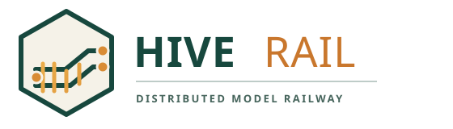

# Hive-Rail

<p align="center">
	
</p>

Hive-Rail is being built to help separate groups of model railway modules operate together as one layout. Instead of relying on one central computer, the plan is for a small computer to look after each powered section of track and share information with the computers looking after neighboring sections.

> **EARLY BETA: USE AT YOUR OWN RISK.** This software has not been tested on real hardware. It is not production-ready or a safety system. Do not connect it to or use it to control a live layout.

This is a very early simulation and networking prototype. It has no connections to a command station, booster, track sensor, signal, or relay. It cannot drive a train or protect a layout. Its RocNet support currently validates and relays test frames over Zenoh only; it is not connected to a local RocNet transport.

Zenoh peer scouting currently discovers nodes on a single local network using `224.0.0.224:7446`, distinct from RocNet/RocRail's `224.0.0.1:4321`. It has only been smoke-tested between two processes on this Mac; discovery across two physical computers is not yet verified.

## Intended use

Think of each future Hive-Rail node as a small signal box for one part of a modular layout. Its intended job is to:

- Keep track of which neighboring sections are connected and responding.
- Leave a boundary signal at **STOP** when a neighbor is missing or a power problem is reported.
- Coordinate a locomotive handoff between separately powered sections. The design aims to prevent two boosters from powering the same rail at once.
- Allow only one controller at a time to drive each locomotive.

These are goals, not finished features. Today this beta can check a module profile, check a simple booster-exclusivity example, and exchange network heartbeats between computers. It cannot yet carry out the railway-control jobs above.

## Intended computers

- **Development, simulation, and observer computers:** Windows 10 or later, macOS, and Linux.
- **Computers intended to live with the layout:** Linux single-board computers such as Raspberry Pi or Orange Pi, connected to suitable railway control hardware.

These are intended targets, not a claim of tested compatibility. So far, the Rust scaffold has been built and tested on macOS only. Windows and Linux builds still need testing, and no Raspberry Pi, Orange Pi, command station, booster, or other real railway hardware has been tested.

The detailed design, unresolved engineering questions, and [RocNet compatibility matrix](https://github.com/CuriousTimo/Hive-Rail/wiki/RocNet-Compatibility-Matrix) are in the [Hive-Rail wiki](https://github.com/CuriousTimo/Hive-Rail/wiki).

## Planned phases

The roadmap follows the [wiki design specification](https://github.com/CuriousTimo/Hive-Rail/wiki/Hive%E2%80%90Rail:-Architecture-and-Design-Specification). Check items as they are completed; a phase is complete only when its gate is met.

- [ ] **Phase 0: Bench spike**
	- [ ] **0.1** Bench-test the transfer block and changeover relay with real decoders, including decoder keep-alive behavior.
	- [ ] **0.2** Capture and record DCC-EX short-circuit output for the firmware and shield in use.
	- [ ] **0.3** Measure Zenoh heartbeat and liveliness detection times on Ethernet and Wi-Fi.
	- [ ] **0.4** Record results and resolve the Phase 0 open questions in the wiki.
- [ ] **Phase 1: Core data**
	- [x] **1.1** Load and deserialize the version 1 module profile JSON.
	- [x] **1.2** Check the schema version, required identity fields, duplicate port IDs, and independent transfer-block sensor/relay requirements.
	- [ ] **1.3** Complete validation for all profile, module, port, and device constraints.
	- [ ] **1.4** Implement two-sided binding confirmation and link status.
	- [ ] **1.5** Build the topology graph and handle node restarts and loss.
	- [ ] **1.6** Add atomic configuration writes, backup recovery, and tests.
- [ ] **Phase 2: Simulator**
	- [ ] **2.1** Model virtual nodes, sensors, turnouts, boosters, and transfer blocks.
	- [x] **2.2** Implement and unit-test a local booster-exclusivity check for fixed sample rail segments.
	- [ ] **2.3** Enforce rail power exclusivity after every simulated event.
	- [ ] **2.4** Add deterministic network, sensor, short-circuit, crash, and restart fault injection.
	- [ ] **2.5** Run seeded scenarios and verify the simulation invariants.
- [ ] **Phase 3: Mesh and safety**
	- [x] **3.1** Exchange Zenoh heartbeat messages between two nodes; smoke-tested over loopback.
	- [ ] **3.2** Test heartbeat timeout and peer-loss behavior across machines and networks.
	- [x] **3.3** Add native Zenoh multicast peer scouting; smoke-tested between two local processes (physical-LAN test still needed).
	- [ ] **3.4** Implement confirmed node bindings and link status.
	- [ ] **3.5** Keep boundary signals at Stop unless every proceed condition is fresh and healthy.
	- [ ] **3.6** Add the SafetyActor and priority emergency command path.
	- [ ] **3.7** Test short-circuit propagation and record measured timing.
	- [ ] **3.8** Define and test bidirectional RocNet message carriage over Zenoh.
- [ ] **Phase 4: Handoff and lease**
	- [ ] **4.1** Implement locomotive district ownership, controller leases, and dead-man timeout.
	- [ ] **4.2** Implement seam arbitration and the transfer-block handoff state machine.
	- [ ] **4.3** Test both travel directions, reversals, timeouts, and faults F1-F8.
	- [ ] **4.4** Pass the simulation exit criteria before connecting hardware.
- [ ] **Phase 5: Hardware drivers**
	- [ ] **5.1** Implement and replay-test the DCC-EX serial driver using recorded transcripts.
	- [ ] **5.2** Add the LocoNet controller proxy for FRED/Fredi.
	- [ ] **5.3** Bench-test on an isolated layout section before any wider trial.
	- [ ] **5.4** Add local RocNet adapters for compatible module equipment.
- [ ] **Phase 6: Peripherals**
	- [ ] **6.1** Add observer and operator interfaces.
	- [ ] **6.2** Add ESP32 accessory controls and displays after validating the gateway approach.
	- [ ] **6.3** Add other non-safety-critical displays and timetable features.

Phase 0 measurements are gates, not paperwork: timing assumptions and hardware behavior must be verified before safety or handoff features are treated as ready for a live layout.

## Requirements

- Rust stable toolchain with `cargo` and `rustc`
- Two computers on a network that permits TCP connections between them

## Build and test

```sh
cargo test
cargo run -- --mode simulation
cargo run -- --validate-profile examples/module_profile.json
```

GitHub Actions runs formatting, Clippy, tests, and a build on Linux, macOS, and Windows for pushes and pull requests. These checks cover desktop software only; they do not test Raspberry Pi or Orange Pi boards or any real railway hardware.

Pushing a tag such as `v0.1.0-beta.1` runs the same checks, builds a native desktop executable on each platform, and publishes a GitHub prerelease with the executables and SHA-256 checksums. The macOS executable is ad-hoc signed to match the project's local Tauri test setup; it is not Developer ID signed or notarized. Gatekeeper may still require manual approval before opening a downloaded copy. These are simulation-only early-beta builds, not hardware-ready software.

## Run two networked simulation nodes

Start one node on each computer on the same LAN. Both must use the same session name and distinct node IDs. In peer mode, Zenoh's native multicast scouting discovers peers automatically; manual endpoints are optional overrides.

On macOS:

```sh
cargo run -- --mode node --session bench --id mac
```

On Windows PowerShell:

```powershell
cargo run -- --mode node --session bench --id windows
```

Allow Zenoh peer traffic through each computer's firewall, including multicast scouting at `224.0.0.224:7446` and the peer transport. This is intentionally separate from RocNet/RocRail's UDP multicast `224.0.0.1:4321`; Hive-Rail does not use RocRail's group for node discovery. The nodes publish a heartbeat every 250 ms on `hive/{session}/node/{id}/hb`. If a known peer's heartbeat is missing for 750 ms, the node logs it as stale. These are draft starting values from the wiki, not validated safety timings.

To send the RocNet identify request after a peer is online:

```sh
cargo run -- --mode node --session bench --id mac --rocnet-address 1 --identify
```

To relay the RocNet reference's unicast speed frame to locomotive address `291`:

```sh
cargo run -- --mode node --session bench --id mac --send-rocnet-hex '@0001230001020203304140'
```

The receiver prints the decoded frame. No physical RocNet UDP, TCP, MQTT, or serial interface is connected yet.

This prototype currently tests only Zenoh peer connectivity and heartbeat freshness. It does not yet test link-binding confirmation, command leases, handoff state machines, partitions, or the simulation invariants across nodes. Do not treat it as a safety system or use it to control a layout.