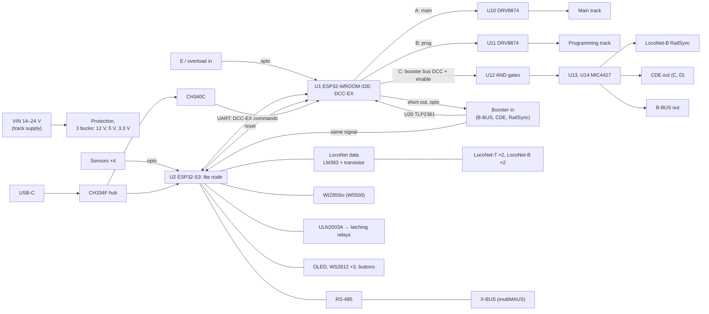

# Hive-Rail board v2: schematic draft

> **Status: draft for review (2026-10-31). Not checked by simulation or a prototype; do not order boards from it.** Values marked *verify* come from other designs or from documents still to read. The design and its reasons are in the wiki: [Hive-Rail Node Board](https://github.com/CuriousTimo/Hive-Rail/wiki/Hive-Rail-Node-Board). The parts list is [`bom.csv`](bom.csv).

The board is a full DCC-EX command station with the Hive-Rail extras, on two ESP32s:

- **U1, ESP32-WROOM-32E:** stock DCC-EX. Its track side is pin-compatible with DCC-EX's EX-CSB1 (`MOTOR_SHIELD_TYPE EXCSB1`), plus a third DCC-EX track for the booster buses.
- **U2, ESP32-S3-WROOM-1-N8R2:** the Hive-Rail lite node: LocoNet, XpressNet, the network, relays, sensors, LEDs and the OLED. The S3 is chosen because the node needs three UARTs (LocoNet, XpressNet, the DCC-EX link); the ESP32-C6 has two plus a limited low-power one.

Part choices come from three working designs: DCC-EX's [EX-CSB1](https://github.com/DCC-EX/EX-CSB1) (DCC side, power, USB protection), positron96's [LocoNet command station](https://oshwlab.com/positron96/loconet-command-station) (CERN-OHL; LocoNet circuit) and our 2021 board (LocoNet, RailSync driver, Ethernet). We use their part choices, not their layouts.



## 1. Power

| Ref | Part | Connections | Notes |
| --- | --- | --- | --- |
| J1 | 2-pole screw terminal 5.08 mm | VIN, GND | District track supply, 14–24 V DC. The track voltage is VIN |
| F1 | Polyfuse or fuse, 5 A | VIN in series | *Verify* against the DRV8874 trip settings |
| Q1 | AO4407C P-MOSFET | VIN reverse-polarity protection, gate to GND through a resistor, 15 V zener gate–source | As EX-CSB1 |
| D1 | SMBJ26A TVS | VIN to GND | Above 24 V, below the DRV8874's 37 V |
| U3 | TPS54302 buck | VIN → **+12 V**, 3 A | LocoNet RailSync drivers, LocoNet-T supply, X-BUS supply, relay coils |
| U4 | TPS54302 buck | VIN → **+5 V**, 3 A | WS2812s, level shifter, OLED (if a 5 V type) |
| U5 | TPS54302 buck | VIN → **+3.3 V**, 3 A | Both ESP32s and the W5500: about 1 A peaks with Wi-Fi |
| L1–L3, C | Inductors and capacitors per the TPS54302 data sheet | | One design, three output voltages (feedback divider) |
| D2–D4 | Green 0603 LEDs | +12 V, +5 V, +3.3 V | Power-good indication |

Three equal bucks keep the parts list short. A 3.3 V linear regulator from 5 V (AMS1117, as EX-CSB1) would dissipate about 1.7 W at 1 A with two ESP32s.

## 2. U1: DCC-EX (ESP32-WROOM-32E)

**Pins.** Tracks A and B as EX-CSB1, so DCC-EX's `EXCSB1` definition holds for them.

| GPIO | Function | Net / to |
| --- | --- | --- |
| 25 | Track A enable (EN/IN1) | U10 EN/IN1 |
| 0 | Track A DCC signal (PH/IN2) | U10 PH/IN2. GPIO0 is a strapping pin; EX-CSB1 uses it with a boot jumper (`IO0_boot_option`): copy that circuit |
| 14 | Track A sleep, active low | U10 nSLEEP |
| 34 | Track A current (input only) | U10 IPROPI, resistor to GND |
| 19 | Track A fault | U10 nFAULT, pull-up |
| 27 | Track B enable | U11 EN/IN1 |
| 15 | Track B DCC signal | U11 PH/IN2 |
| 2 | Track B sleep, active low | U11 nSLEEP |
| 35 | Track B current (input only) | U11 IPROPI |
| 23 | Track B fault | U11 nFAULT |
| 5 | Track C (booster buses) DCC signal | U12 |
| 18 | Track C enable | U12 |
| 32 | Booster input (`BOOSTER_INPUT 32`, as EX-CSB1) | U20 output |
| 16 / 17 | Serial2 RX / TX (`SERIAL2_COMMANDS`, DCC-EX's default pins) | U2 UART2 TX / RX |
| 36 | Booster short in (E of CDE, overload of B-BUS out; input only) | U21 output, pull-up |
| 4 | Short line out to the master (booster mode) | U22 LED through 1 kΩ |
| 33 | Stop button (to GND, pull-up) | SW1 |
| 26 | Go button | SW2 |
| 1 / 3 | UART0 TX / RX | U31 (CH340C): USB console and flashing |
| EN | Reset | Auto-reset from U31; reset from U2 through Q5 |
| 21 / 22 | I²C, spare | Header J30 |

**DCC-EX configuration** (`config.h`, stock DCC-EX):

```cpp
// Tracks A (main) and B (programming) as EX-CSB1; C feeds the booster buses
// (LocoNet-B RailSync, CDE, B-BUS out): no current sense, boosters measure.
#define HIVE_RAIL_BOARD_V2 F("HIVERAIL_V2"), \
  new MotorDriver(25,  0, UNUSED_PIN, -14, 34, 2.23, 5000, 19), \
  new MotorDriver(27, 15, UNUSED_PIN,  -2, 35, 2.23, 5000, 23), \
  new MotorDriver(18,  5, UNUSED_PIN, UNUSED_PIN, UNUSED_PIN, 1.0, 5000, UNUSED_PIN)
#define MOTOR_SHIELD_TYPE HIVE_RAIL_BOARD_V2
#define BOOSTER_INPUT 32
#define SERIAL2_COMMANDS
```

`myAutomation.h`: stop and go (`ONBUTTON(33) POWEROFF`, `ONBUTTON(26) POWERON`), the booster short in on GPIO36 as a power off, the short line out from `ONOVERLOAD`, and booster mode on `ONRAILSYNCON` (`SET_TRACK(A, BOOST)`). In booster mode DCC-EX routes GPIO32 to the track outputs in the ESP32's GPIO matrix (hardware, no software in the path).

## 3. Track outputs

| Ref | Part | Connections |
| --- | --- | --- |
| U10, U11 | DRV8874PWPR, PH/EN mode | VM = VIN; OUT1/OUT2 to J10 (main) and J11 (programming track); IPROPI to the ESP32's ADC through the sense resistor; IMODE and VREF as EX-CSB1 |
| J10, J11 | 2-pole screw terminals 5.08 mm | Main track, programming track |
| C | 100 µF / 35 V bulk, 100 nF per driver | As EX-CSB1 |
| D5, D6 | Yellow 0603 LEDs | Track A and B on |

The sense resistor and DCC-EX's sense factor (2.23 on EX-CSB1) belong together: copy EX-CSB1's resistor, *verify* in its schematic.

## 4. Booster buses out (LocoNet-B RailSync, CDE, B-BUS)

DCC-EX's track C drives all three: when DCC-EX switches the district off, the booster signal stops and the boosters switch off.

| Ref | Part | Connections | Notes |
| --- | --- | --- | --- |
| U12 | 74LVC2G08 (two AND gates) and an inverter (74LVC1G04) | DCC_C = signal AND enable; /DCC_C = NOT signal AND enable | Both outputs low when the district is off |
| U13 | MIC4427 (two non-inverting drivers), 12 V | DCC_C, /DCC_C → **LocoNet-B RailSync** pins 1 and 6 through 47 Ω each | Current-limited per the LocoNet spec, *verify* (positron96's v2 goal) |
| U14 | MIC4427, 12 V | → **CDE C and D** (J12) and **B-BUS out** pin 1 (J13), through series resistors | CDE and B-BUS signal levels *verify* (wiki NB-Q16) |
| U21 | PC817 optocoupler (two: CDE E, B-BUS pin 4) | Booster pulls E or overload to its ground → LED; transistor pulls U1 GPIO36 low | Wired-OR of both inputs |
| J12 | 3-pole screw terminal (C, D, E) | | Lenz CDE |
| J13 | B-BUS out, 4-pole (pin 1 DCC, 2–3 GND, 4 overload in) | | Pinout from a forum post; connector type *verify* (NB-Q16) |

## 5. Booster input (mode 5) and the DCC sniffer

| Ref | Part | Connections | Notes |
| --- | --- | --- | --- |
| J14 | B-BUS in, 4-pole | Pin 1 DCC in, 2–3 GND (master side), 4 short line out | From a Z21's B-BUS |
| J15 | 3-pole screw terminal | C, D in; E out | From a CDE or RailSync output (Intellibox) |
| U20 | TLP2361 fast optocoupler | LED: input through 2.2 kΩ, 1N4148 reverse across the LED (accepts C/D or DCC/GND); output to **U1 GPIO32 and U2 GPIO7** | Input resistor for 12–22 V signals, *verify* against B-BUS levels |
| U22 | PC817 | LED from U1 GPIO4; transistor collector to J14 pin 4 and J15 E, emitter to the master's ground | Pulls the master's short line |

The input side of U20 and U22 is the master's ground, never the board's: the two systems stay separate.

## 6. U2: lite node (ESP32-S3-WROOM-1-N8R2)

| GPIO | Function | Net / to |
| --- | --- | --- |
| 4 / 5 | UART1 RX / TX: LocoNet (16 666 baud, TX inverted) | LocoNet receiver output / transmitter base |
| 17 / 18 | UART2 TX / RX: DCC-EX link (115 200 baud) | U1 GPIO16 / 17 |
| 43 / 44 | UART0 TX / RX: XpressNet (62 500 baud, 9 bits by the parity trick) | U23 DI / RO |
| 6 | XpressNet direction | U23 DE and /RE |
| 7 | DCC sniffer in | U20 output (booster DCC) |
| 10 / 11 / 12 / 13 | SPI CS / MOSI / SCK / MISO | J20 (WIZ850io) |
| 9 / 8 | W5500 interrupt / reset | J20 |
| 1 / 2 | I²C SDA / SCL | OLED J31, STEMMA QT J32 |
| 38 | WS2812 data | U24 (74AHCT1G125, 3.3 → 5 V) → LED1–LED3 |
| 14 | Reset of U1 | Q5 (NPN, collector to U1 EN) |
| 15 / 16 / 21 / 47 | Relay coils: relay 1 set / reset, relay 2 set / reset | U25 (ULN2003A) inputs 1–4 |
| 39 / 40 / 41 / 42 | Sensor inputs 1–4 | U26 (TLP291-4, four optocouplers) outputs, pull-ups |
| 0 | Boot and user button (config) | SW3 |
| 19 / 20 | Native USB D− / D+ | U30 (hub) downstream port 1: console and flashing |
| EN | Reset | SW4, RC |

GPIO3, 45 and 46 are strapping pins and stay free; 35–37 are free with quad PSRAM (N8R2).

## 7. LocoNet

| Ref | Part | Connections | Notes |
| --- | --- | --- | --- |
| J40, J41 | RJ12 6P6C (DS1133-S60BPX) | **LocoNet-T**: pins 3–4 data, 2–5 GND, 1–6 +12 V through F40 | Throttle supply on the RailSync pins, *verify* against Uhlenbrock's LocoNet-T |
| J42, J43 | RJ12 6P6C | **LocoNet-B**: pins 3–4 data, 2–5 GND, 1–6 RailSync DCC from U13 | |
| F40 | Polyfuse 500 mA | +12 V to LocoNet-T | |
| U40 | LM393 comparator | Data line through a divider to + input, reference to − input, hysteresis resistor, output pull-up to 3.3 V → U2 GPIO4 | Values as positron96's v1 (27k, 12k, 30k, 91k, 330k, 10k), *verify* in its schematic |
| Q40 | MMBT3904 | Base from U2 GPIO5 through 2 kΩ; collector to the data line through 47 Ω | Open-collector transmitter |
| U41, JP40 | LM317L as a current source, with a jumper | +12 V to the data line | The bus pull-up, only on the bus master: jumper fitted when this board is the LocoNet master (always, by Hive-Rail's design); *verify* the current against the LocoNet spec |
| D40 | TVS on the data line | | Protection |

## 8. XpressNet (multiMAUS)

| Ref | Part | Connections | Notes |
| --- | --- | --- | --- |
| U23 | SN65HVD72 (3.3 V RS-485, half duplex) | A, B to J50 pins 4 and 3 | |
| R50–R52 | 680 Ω, 680 Ω bias, 120 Ω termination with jumper JP50 | | Fail-safe idle |
| D50 | SM712 TVS | A, B | |
| J50, J51 | RJ12 6P6C | 1 C (DCC, not connected by default), 2 GND, 3 B, 4 A, 5 +12 V through F50, 6 D (not connected) | Lenz pinout; Roco cable *verify* (NB-Q14) |
| F50 | Polyfuse 300 mA | +12 V to X-BUS | Powers the multiMAUS |

## 9. Network

| Ref | Part | Notes |
| --- | --- | --- |
| J20 | 2×6 pin header for a WIZ850io module (W5500 with RJ45 and magnetics) | Optional; the magnetics isolate the network |

## 10. Transfer relays and sensors

| Ref | Part | Connections | Notes |
| --- | --- | --- | --- |
| U25 | ULN2003A | Inputs from U2; outputs sink the relay coils from +12 V; COM to +12 V (built-in flyback diodes) | Two dual-coil latching relays, three spare channels |
| J60 | 6-pole screw terminal | +12 V, coil 1 set, coil 1 reset, coil 2 set, coil 2 reset, GND | The relays themselves sit at the transfer blocks (double-pole changeover) |
| U26 | TLP291-4 (four optocouplers) | Input: sensor through 2.2 kΩ and a 1N4148, from its own supply; output to U2 | Isolated sensor inputs |
| J61 | 8-pole screw terminal | Four sensor pairs | |

## 11. User interface

| Ref | Part | Notes |
| --- | --- | --- |
| SW1, SW2 | Red and green push buttons | Stop and go, on U1 |
| SW3, SW4 | Small push buttons | U2 boot/config and reset |
| SW5 | Small push button | U1 reset |
| LED1–LED3 | WS2812B-2020 | Power, link, layout |
| U24 | 74AHCT1G125 | 3.3 V → 5 V level shift for the WS2812s |
| J31 | 4-pin header | 128x64 OLED (SSD1306 or SH1106, I²C) |
| J32 | STEMMA QT / Qwiic (JST-SH 4-pin) | I²C accessories |

## 12. USB

| Ref | Part | Notes |
| --- | --- | --- |
| J70 | USB-C receptacle (USB 2.0), 5.1 kΩ on CC1 and CC2 | One cable for both chips |
| U32 | USBLC6-2SC6 | ESD protection (as EX-CSB1) |
| U30 | CH334F USB 2.0 hub | Port 1 to U2's native USB; port 2 to U31 |
| U31 | CH340C USB-serial | U1 UART0, with auto-reset (DTR, RTS) |
| Q6 | UMH3N (two transistors) | U1 auto-reset: EN and GPIO0, as EX-CSB1 |

## 13. Mechanical

- Board size about 100 × 80 mm (*to fit the parts*), four mounting holes; a DIN-rail case is a later option.
- Screw terminals on one edge (power, tracks, boosters, relays, sensors), RJ12 jacks on another (LocoNet, X-BUS), USB-C, Ethernet and the buttons accessible.

## 14. Open points in this draft

- Every *verify* above, especially: CDE and B-BUS levels and connectors (NB-Q16), the X-BUS cable pinout (NB-Q14), LocoNet-T supply and bus pull-up current, the LM393 values.
- EX-CSB1's GPIO0 boot circuit, IPROPI resistor and DRV8874 IMODE/VREF settings: copy exactly from its schematic.
- Whether U1 also needs access to the node's network for DCC-EX's own WiThrottle at home (mode 1): over Wi-Fi it has its own.
- Thermal: the DRV8874s at 3 A each, and three bucks on one board.
