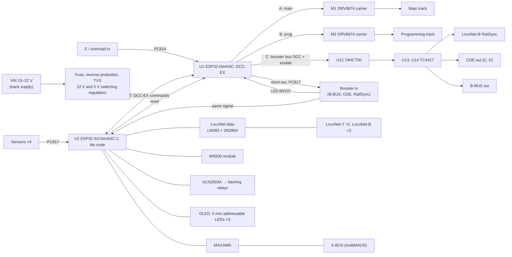

# Hive-Rail board v2: schematic draft

> **Status: draft, first review done (2026-10-31, see 16). Not checked by simulation or a prototype; do not order boards from it.** Values marked *verify* come from other designs or from documents still to read. The design and its reasons are in the wiki: [Hive-Rail Node Board](https://github.com/CuriousTimo/Hive-Rail/wiki/Hive-Rail-Node-Board). The parts list is [`bom.csv`](bom.csv).

**Build style: through-hole first, modules on pin headers (decision 2026-10-31).** Every part can be soldered by hand without SMD work: the ESP32s, the track drivers, the regulators, Ethernet and the OLED are common modules that plug onto the board on 2.54 mm pin headers (12); everything else is through-hole. This keeps the board buildable by module owners at home, as the 2021 board was. A machine-assembled SMD variant can follow for batches (14).

The board is a full DCC-EX command station with the Hive-Rail extras, on two ESP32 development boards:

- **U1, ESP32-DevKitC (ESP32-WROOM-32E):** stock DCC-EX. Its track signals are on EX-CSB1's pins, so DCC-EX's `EXCSB1` motor driver values hold, plus a third DCC-EX track for the booster buses.
- **U2, ESP32-S3-DevKitC-1 (N8 or N8R2):** the Hive-Rail lite node: LocoNet, XpressNet, the network, relays, sensors, LEDs and the OLED. The S3 is chosen because the node needs three UARTs (LocoNet, XpressNet, the DCC-EX link); the ESP32-C6 has two plus a limited low-power one.

Each development board brings its own USB port, USB-serial chip, auto-reset and 3.3 V regulator, so the board needs no USB circuit of its own.

Part choices come from three working designs: DCC-EX's [EX-CSB1](https://github.com/DCC-EX/EX-CSB1) (DCC side), positron96's [LocoNet command station](https://oshwlab.com/positron96/loconet-command-station) (CERN-OHL; LocoNet circuit) and our 2021 board (LocoNet, RailSync driver, Ethernet). We use their part choices, not their layouts.



## 1. Power

| Ref | Part | Connections | Notes |
| --- | --- | --- | --- |
| J1 | 2-pole screw terminal 5.08 mm, 10 A | VIN, GND | District track supply, **15 to 22 V DC**. The track voltage is VIN |
| F1 | Fuse 5 A fast, 5×20 mm, in a PCB fuse holder | VIN in series | |
| Q1 | IRF4905 P-MOSFET (TO-220, 55 V) | Reverse-polarity protection: in the VIN line, gate to GND through 10 kΩ, 15 V zener (1N4744A) gate–source | Almost no voltage drop, unlike a diode |
| D1 | 1.5KE27A TVS (axial) | VIN to GND | Conducts above about 25.7 V |
| U3 | 12 V switching regulator, 3-pin 7805 footprint, 1 A, input up to 36 V (Mornsun K7812-1000R3 or equal) | VIN → **+12 V** | LocoNet RailSync drivers, LocoNet-T supply, X-BUS supply, relay coils, LM393. Needs VIN ≥ 15 V |
| U4 | 5 V switching regulator, same type, 2 A (K7805-2000R3 or equal) | VIN → **+5 V** | Both development boards (their 5V pins; they make 3.3 V themselves), the W5500 module, the addressable LEDs, 74HCT logic, the 6N137 |
| C1–C4 | 100 µF / 35 V electrolytic and 100 nF on VIN, +12 V and +5 V | | Per the regulator data sheets |
| D2, D3 | Green 3 mm LEDs | +12 V, +5 V | Power indication |

- **Input range 15 to 22 V** covers H0 and 0 track supplies. The TVS conducts from about 25.7 V and clamps below 38 V at its full rated surge; the regulators are rated 36 V (*verify* the surge rating of the chosen type, or pick a 72 V input type if affordable). The DRV8874 is rated 37 V.
- **N scale (12 to 14 V track):** a 12 V regulator cannot work there; the LocoNet 12 V would have to come from VIN through a diode (open point, 13).
- **USB only:** each development board runs from its own USB cable for flashing and tests, without track power. *Verify* that each development board has a diode between its USB VBUS and its 5V pin, so the board's +5 V does not feed the computer's USB port; the official DevKitC boards do, clones vary.

## 2. U1: DCC-EX (ESP32-DevKitC)

**Pins.** Tracks A and B on EX-CSB1's pins.

| GPIO | Function | To |
| --- | --- | --- |
| 25 | Track A enable | M1 EN/IN1 |
| 0 | Track A DCC signal | M1 PH/IN2. GPIO0 is a strapping pin (the DevKitC's BOOT button and auto-reset): M1's input must not pull it low at reset (the DRV8874 input has an internal pull-down of about 100 kΩ, which the DevKitC's 10 kΩ pull-up overrides, *verify*) |
| 14 | Track A sleep, active low | M1 nSLEEP |
| 34 | Track A current (input only) | M1 current sense output |
| 19 | Track A fault | M1 nFAULT, 10 kΩ pull-up to 3.3 V |
| 27 | Track B enable | M2 EN/IN1 |
| 15 | Track B DCC signal | M2 PH/IN2 |
| 2 | Track B sleep, active low | M2 nSLEEP |
| 35 | Track B current (input only) | M2 current sense output |
| 23 | Track B fault | M2 nFAULT, 10 kΩ pull-up |
| 5 | Track C (booster buses) DCC signal | U12 |
| 18 | Track C enable | U12 |
| 32 | Booster input (`BOOSTER_INPUT 32`, as EX-CSB1) | U20 output |
| 16 / 17 | Serial2 RX / TX (`SERIAL2_COMMANDS`, DCC-EX's default pins) | U2 GPIO17 / 18 |
| 36 | Booster short in (CDE E, B-BUS overload; input only) | U21 outputs, 10 kΩ pull-up |
| 4 | Short line out to the master (booster mode) | U22 LED through 1 kΩ |
| 33 | Stop button (to GND, 10 kΩ pull-up) | SW1, front panel |
| 26 | Go button | SW2, front panel |
| EN | Reset | DevKitC's own; also Q5 from U2 |
| 21 / 22 | I²C, spare | Header J30 |

**DCC-EX configuration** (`config.h`, stock DCC-EX):

```cpp
// Tracks A (main) and B (programming) on EX-CSB1's pins; C feeds the booster buses
// (LocoNet-B RailSync, CDE, B-BUS out): no current sense, boosters measure.
// Sense factor: Pololu's DRV8874 carrier gives its own current-sense scale (verify; EX-CSB1 uses 2.23).
#define HIVE_RAIL_BOARD_V2 F("HIVERAIL_V2"), \
  new MotorDriver(25,  0, UNUSED_PIN, -14, 34, 2.23, 5000, 19), \
  new MotorDriver(27, 15, UNUSED_PIN,  -2, 35, 2.23, 5000, 23), \
  new MotorDriver(18,  5, UNUSED_PIN, UNUSED_PIN, UNUSED_PIN, 1.0, 5000, UNUSED_PIN)
#define MOTOR_SHIELD_TYPE HIVE_RAIL_BOARD_V2
#define BOOSTER_INPUT 32
#define SERIAL2_COMMANDS
```

`myAutomation.h`: `SET_TRACK(C, MAIN)` at start, stop and go (`ONBUTTON(33) POWEROFF`, `ONBUTTON(26) POWERON`), the booster short in on GPIO36 as a power off, the short line out from `ONOVERLOAD`, and booster mode on `ONRAILSYNCON` (`SET_TRACK(A, BOOST)`). In booster mode DCC-EX routes GPIO32 to the track outputs in the ESP32's GPIO matrix (hardware, no software in the path).

## 3. Track outputs

| Ref | Part | Connections | Notes |
| --- | --- | --- | --- |
| M1, M2 | **Pololu DRV8874 single brushed DC motor driver carrier**, on 2.54 mm socket strips | VIN, GND; EN/IN1, PH/IN2, nSLEEP, nFAULT, current sense to U1; PMODE tied for PH/EN mode; OUT1/OUT2 to J10 (main) and J11 (programming track) | The same chip as EX-CSB1, so the DCC-EX setup stays the same; about 3 A continuous per carrier (Pololu's figure, *verify*). Current-sense scale per Pololu's documentation |
| J10, J11 | 2-pole screw terminals 5.08 mm, 10 A | Main track, programming track | |
| D8, D9 | P6KE30CA bidirectional TVS (axial) | Across each track output | Spikes and ESD from the track |
| C10, C11 | 100 µF / 35 V electrolytic | VIN at each carrier | Bulk capacitance |
| J16 | 2×4 pin header, track A signals (EN, PH, nSLEEP, current sense, fault, 3.3 V, GND) | In parallel with M1's socket | For an **IBT-2 (BTS7960) module** instead of M1, for more than 3 A on the main track: leave M1 out and wire the IBT-2 here. DCC-EX supports the IBT-2 and recommends at most 5 A for N and H0 |

**Driver alternatives considered:**

| Driver | Price (roughly) | For | Against |
| --- | --- | --- | --- |
| **Pololu DRV8874 carrier** (chosen) | €10–15 each | Same chip as EX-CSB1 and DCC-EX's EX-MotorShield8874; current sense; small; through-hole pins | Dearest of the modules |
| IBT-2 (BTS7960) | €5–8 | Very high current, DCC-EX supported, sold everywhere | Large; more current than a district's own track should get; prog track sensing coarse |
| L298N chip on the board (Multiwatt-15, through-hole) | €2–4 | Cheapest, as positron96's v1 and the Arduino Motor Shield | Drops 2 to 4 V, needs a heat sink, old design |
| DRV8874 chip (SMD with thermal pad) | about $0.60–0.90 at LCSC (C1855818) | Cheapest overall | SMD only: for the machine-assembled variant (14) |

## 4. Booster buses out (LocoNet-B RailSync, CDE, B-BUS)

DCC-EX's track C drives all three: when DCC-EX switches the district off, the booster signal stops and the boosters switch off.

| Ref | Part | Connections | Notes |
| --- | --- | --- | --- |
| U12 | 74HCT00 (DIP-14, four NAND gates), +5 V | DCC_C = signal AND enable; /DCC_C = NOT signal AND enable | HCT inputs take the ESP32's 3.3 V. Both outputs low when the district is off |
| U13 | TC4427 (DIP-8, two non-inverting drivers), +12 V | DCC_C, /DCC_C → **LocoNet-B RailSync** pins 1 and 6, each through 150 Ω and a 100 mA polyfuse | A shorted RailSync pin draws about 80 mA, which the driver survives; *verify* against the LocoNet spec |
| U14 | TC4427, +12 V | → **CDE C and D** (J12) and **B-BUS out** pin 1 (J13), through 150 Ω each | CDE and B-BUS levels *verify* (wiki NB-Q16) |
| U21 | 2× PC814 (DIP-4, AC-input optocoupler), LED fed from +12 V through 2.2 kΩ | CDE E and B-BUS pin 4 → LED; transistors pull U1 GPIO36 low | AC input: works whichever way the booster's E circuit is referenced (C, D or its ground), which is still to measure. Wired-OR |
| J12 | 3-pole screw terminal (C, D, E) | | Lenz CDE |
| J13 | B-BUS out, 4-pole (pin 1 DCC, 2–3 GND, 4 overload in) | | Pinout from a forum post; connector type *verify* (NB-Q16) |

## 5. Booster input (mode 5) and the DCC sniffer

| Ref | Part | Connections | Notes |
| --- | --- | --- | --- |
| J14 | B-BUS in, 4-pole | Pin 1 DCC in, 2–3 GND (master side), 4 short line out | From a Z21's B-BUS |
| J15 | 3-pole screw terminal | C, D in; E out | From a CDE or RailSync output (Intellibox) |
| U20 | 6N137 (DIP-8, 10 Mbit/s optocoupler), output side on +5 V | LED through a **constant-current source** (two 2N3904, about 8 mA) with a 1N4148 reverse across the LED (accepts C/D or DCC/GND); open-collector output pulled up to **3.3 V** → U1 GPIO32 and U2 GPIO7 | The current source takes any DCC level from 5 to 24 V; a fixed resistor would give too little at 5 V and too much at 22 V. A slow optocoupler (PC817) would skew DCC's 58 µs half-bits |
| U22 | PC817 (DIP-4) | LED from U1 GPIO4 through 1 kΩ; transistor between J14 pin 4 / J15 E and the master's ground | Pulls the master's short line |

The input side of U20 and U22 is the master's ground, never the board's: the two systems stay separate.

## 6. U2: lite node (ESP32-S3-DevKitC-1)

| GPIO | Function | To |
| --- | --- | --- |
| 4 / 5 | UART1 RX / TX: LocoNet (16 666 baud, TX inverted) | U40 output / Q40 base |
| 17 / 18 | UART2 TX / RX: DCC-EX link (115 200 baud) | U1 GPIO16 / 17 |
| 47 / 21 | UART0 TX / RX, moved off GPIO43/44: XpressNet (62 500 baud, 9 bits by the parity trick) | U23 DI / RO |
| 6 | XpressNet direction | U23 DE and /RE, 10 kΩ pull-down |
| 7 | DCC sniffer in | U20 output |
| 10 / 11 / 12 / 13 | SPI CS / MOSI / SCK / MISO | J20 (W5500 module) |
| 9 / 8 | W5500 interrupt / reset | J20 |
| 1 / 2 | I²C SDA / SCL, 4.7 kΩ pull-ups | OLED J31, I²C header J32 |
| 48 | Addressable LED data | U24 (74HCT125, 3.3 → 5 V) → LED1–LED3 |
| 14 | Reset of U1 | Q5 (2N3904, collector to U1 EN), 10 kΩ base pull-down |
| 15 / 16 / 39 / 40 | Relay coils: relay 1 set / reset, relay 2 set / reset | U25 (ULN2003A) inputs, 10 kΩ pull-downs |
| 41 / 42 / 19 / 20 | Sensor inputs 1–4 | U26 (4× PC817) outputs, 10 kΩ pull-ups |
| 0 | Boot and user button (config) | The DevKitC's BOOT button |

- **Pins left free on purpose:** GPIO3, 45 and 46 (strapping), 35–37 (octal PSRAM on N8R8 boards), 43/44 (the DevKitC's USB-serial chip), 38 (the DevKitC's own RGB LED on board version 1.1; on version 1.0 it sits on GPIO48, where it then shows the same colour as LED1, which does no harm).
- GPIO19 and 20 are the S3's native USB; the board uses the DevKitC's USB-serial port for flashing and the console, so they are free as inputs.
- **Recheck this pin plan against the DevKitC bought:** clones differ.

## 7. LocoNet

| Ref | Part | Connections | Notes |
| --- | --- | --- | --- |
| J40, J41 | RJ12 6P6C, through-hole | **LocoNet-T**: pins 3–4 data, 2–5 GND, 1–6 +12 V through F40 | Throttle supply on the RailSync pins, *verify* against Uhlenbrock's LocoNet-T |
| J42, J43 | RJ12 6P6C | **LocoNet-B**: pins 3–4 data, 2–5 GND, 1–6 RailSync DCC from U13 | |
| F40 | Radial polyfuse 500 mA, 30 V or more | +12 V to LocoNet-T | |
| U40 | LM393 (DIP-8), **supplied from +12 V** | Data line through a divider to + input, reference to − input, hysteresis resistor; open-collector output pulled up to **3.3 V** → U2 GPIO4 | From 12 V its inputs see the whole bus swing (an LM393 input must stay 1.5 V below its supply); the open-collector output stays safe for the ESP32. Values as positron96's v1 (27k, 12k, 30k, 91k, 330k, 10k), *verify* in its schematic |
| Q40 | 2N3904 (TO-92) | Base from U2 GPIO5 through 2 kΩ; collector to the data line through 47 Ω | Open-collector transmitter |
| U41, JP40 | LM317LZ (TO-92) as a current source, with a jumper | +12 V to the data line | The bus pull-up, only on the bus master: jumper fitted when this board is the master; *verify* the current against the LocoNet spec |
| D40 | P6KE15CA TVS | Data line to GND | Protection |

## 8. XpressNet (multiMAUS)

| Ref | Part | Connections | Notes |
| --- | --- | --- | --- |
| U23 | MAX3485 (DIP-8, 3.3 V RS-485, half duplex) | A, B to J50 pins 4 and 3; DE and /RE from U2 GPIO6 with a 10 kΩ pull-down | The pull-down keeps the transceiver receiving while the ESP32 boots |
| R50–R52 | 680 Ω, 680 Ω bias, 120 Ω termination with jumper JP50 | | Fail-safe idle |
| D50, D51 | P6KE12CA TVS | A and B to GND | RS-485 common-mode range is −7 to +12 V |
| J50, J51 | RJ12 6P6C | 1 C (DCC, not connected by default), 2 GND, 3 B, 4 A, 5 +12 V through F50, 6 D (not connected) | Lenz pinout; Roco cable *verify* (NB-Q14) |
| F50 | Radial polyfuse 300 mA, 30 V or more | +12 V to X-BUS | Powers the multiMAUS |

## 9. Network

| Ref | Part | Notes |
| --- | --- | --- |
| J20 | 2×5 pin socket for the common blue **W5500 Ethernet module** (RJ45 with magnetics, its own 3.3 V regulator), powered from +5 V | Optional. The cheapest widely sold W5500 module; clones differ in pin order, so the silkscreen names one pinout (*verify* with the module bought). The magnetics isolate the network |

## 10. Transfer relays and sensors

| Ref | Part | Connections | Notes |
| --- | --- | --- | --- |
| U25 | ULN2003A (DIP-16) | Inputs from U2, each with a 10 kΩ pull-down; outputs sink the relay coils from +12 V; COM to +12 V (built-in flyback diodes) | Two dual-coil latching relays, three spare channels. The pull-downs keep a booting ESP32 from pulsing a coil, which would flip a latching relay |
| J60 | 6-pole screw terminal 3.5 mm | +12 V, coil 1 set, coil 1 reset, coil 2 set, coil 2 reset, GND | The relays themselves sit at the transfer blocks (double-pole changeover) |
| U26 | 4× PC817 (DIP-4) | Input: sensor through 2.2 kΩ and a 1N4148, from its own supply; output to U2 | Isolated sensor inputs |
| J61 | 8-pole screw terminal 3.5 mm | Four sensor pairs | |

## 11. User interface

| Ref | Part | Notes |
| --- | --- | --- |
| SW1, SW2 | 12 mm push buttons, red and green caps | Stop and go, on U1 |
| SW3 | 6 mm push button | U1 reset (the DevKitC's own buttons are hard to reach once plugged in) |
| LED1–LED3 | 5 mm through-hole addressable RGB LEDs (WS2812D-F5 or PL9823) | Power, link, layout |
| U24 | 74HCT125 (DIP-14), +5 V | 3.3 V → 5 V level shift for the LEDs |
| J31 | 4-pin header | 128x64 OLED module (SSD1306 or SH1106, I²C) |
| J32 | 4-pin I²C header (3.3 V, GND, SDA, SCL) | I²C accessories (Qwiic and STEMMA QT through an adapter cable) |
| J33 | 2×5 pin header, **front panel** | Stop and go buttons and the three LEDs, in parallel with the ones on the board, for a module fascia |

## 12. Mechanical and plug-in modules

**Modules plug onto the board on 2.54 mm pin headers:**

| Module | Header | Where to buy |
| --- | --- | --- |
| U1 ESP32-DevKitC, U2 ESP32-S3-DevKitC-1 | Two rows each | Espressif or clones (AliExpress) |
| M1, M2 Pololu DRV8874 carrier | Two rows, power and motor pins on the same grid | Pololu and its resellers |
| U3, U4 3-pin switching regulators (K7812, K7805 type) | 3 pins | AliExpress, electronics shops |
| W5500 Ethernet module | 2×5 | AliExpress |
| OLED 128x64 I²C | 4 pins | AliExpress |

Not plug-in: the IBT-2 and the L298N modules have screw terminals for power and the motor. They stay a cabled option for more track current (J16 and screw terminals), not the standard. LM2596 buck boards do not fit either: their corner pads are not on a 0.1" grid and differ per seller.

**Rules:**

- **Current per pin:** a 2.54 mm header pin carries about 3 A. Nets of 2 A or more use at least two pins in parallel; the 5 A path through a driver carrier (VIN, GND, OUT1, OUT2) uses every pin the carrier has for it, and three where it allows.
- **Female headers on the board, male pins on the modules.** Each module's outline and pin 1 printed on the silkscreen; headers laid out so a module cannot be plugged one row off or turned round (a dummy or missing pin, or an asymmetric row). A wrongly plugged module can destroy itself or the ESP32.
- **Hold-downs:** the board travels to meetings. Modules with mounting holes (development boards, W5500) get standoffs, not only their headers.
- **Keep-out:** no tall parts under a plugged-in module; height limit from the female header chosen (8.5 mm standard).
- **One pinout per module, named on the board:** AliExpress clones differ in pin order (W5500) and in which pins exist (development boards). The board documents the exact module it expects.

**Board:**

- Size about 160 × 100 mm with the modules (*to fit*), four mounting holes; a DIN-rail case is a later option.
- Screw terminals on one edge (power, tracks, boosters, relays, sensors), RJ12 jacks on another (LocoNet, X-BUS); the development boards' USB ports and the Ethernet jack reachable from the edge.

## 13. Open points in this draft

- Every *verify* above, especially: CDE and B-BUS levels and connectors (NB-Q16), the X-BUS cable pinout (NB-Q14), LocoNet-T supply and bus pull-up current, the LM393 values, the DRV8874 carrier's current-sense scale.
- N-scale track supplies (12 to 14 V): where the LocoNet 12 V comes from.
- The regulators' surge rating against the TVS clamp voltage.
- Thermal: two DRV8874 carriers at 3 A, and two switching regulators.

## 14. Machine-assembled variant (later)

For a batch assembled by a factory (JLCPCB), the same schematic with SMD parts is cheaper per board: ESP32-WROOM-32E and ESP32-S3-WROOM-1 modules instead of development boards (then with a USB hub, a CH340C, USB-C and ESD protection on the board), DRV8874 chips, buck converter chips, SMD optocouplers and logic. The first draft of this file (git history) lists those parts.

## 15. PCB rules: current and track widths

Track widths from IPC-2221 for **outer layers and a 10 °C rise**. The current to design for is the largest one that can flow for longer than a moment: the fuse's 5 A on the power path, the trip current elsewhere.

| Current | 1 oz copper (35 µm) | 2 oz copper (70 µm) |
| --- | --- | --- |
| 0.5 A | 0.12 mm (use 0.25 mm) | 0.25 mm |
| 1 A | 0.30 mm | 0.15 mm (use 0.25 mm) |
| 2 A | 0.78 mm | 0.39 mm |
| 3 A | 1.37 mm | 0.68 mm |
| 5 A | 2.77 mm | 1.38 mm |
| 6 A | 3.56 mm | 1.78 mm |

**Rules for the layout:**

| Net | Design current | Rule |
| --- | --- | --- |
| VIN: J1 → F1 → Q1 → driver carriers and regulators | 5 A (fuse) | Copper pours, at least 3 mm wide on 1 oz, on both layers stitched with vias |
| Track outputs: carrier OUT1/OUT2 → D8/D9 → J10/J11 | 5 A (DCC-EX trips at 5 A; the DRV8874 limits near 6 A) | Pours at least 3 mm on 1 oz, both layers |
| GND return from the track outputs | Same as VIN | Solid ground pour on the bottom layer; no slots under the power path |
| +12 V from U3 | 1 A | 0.5 mm trunk and branches |
| +5 V from U4 | 2 A | 1.0 mm trunk, 0.5 mm branches |
| RailSync, CDE, B-BUS outputs | Under 0.2 A (resistors and polyfuses) | 0.4 mm |
| LocoNet data, RS-485, signals | Milliamps | 0.25 mm; RS-485 A and B as a pair |

- **Copper:** order 2 oz outer copper, or keep 1 oz and use pours; JLCPCB charges extra for 2 oz. Rev A: 2 oz, the safer choice until the boards are measured warm.
- **Through-hole pads carrying current** (terminals, fuse holder, Q1, carrier pins): generous annular rings, and the pour connected with wide thermal spokes or solid, so 5 A does not run through four thin spokes.
- **Vias carrying current:** count about 1 A per 0.3 mm via; at least 6 vias where 5 A changes layer.
- **Isolation gaps:** no copper under the optocouplers between their two sides, and at least 2 mm between the master's side of the booster input (J14, J15, U20 and U22 inputs) and the board's ground. This is about keeping the systems apart, not about voltage: everything is below 30 V.
- **Separation:** keep the track outputs and the driver carriers away from the LM393, the RS-485 transceiver and the ESP32 antennas; the development boards' antennas at the board edge with no copper under them.

## 16. Review 2026-10-31: findings and changes

| # | Finding | Change |
| --- | --- | --- |
| R1 | Buck chips rated 28 V on VIN: no margin for track-supply spikes | Switching regulators rated 36 V; VIN range 15 to 22 V |
| R2 | 5 A polyfuse in 1812: such parts are mostly rated 6 to 16 V | 5 A fast fuse in a holder; all polyfuses radial, rated 30 V or more |
| R3 | TVS clamping above what the regulators survive | 1.5KE27A with a 15 to 22 V input range; surge rating to verify |
| R4 | LM393 on 3.3 V cannot see the 12 V LocoNet bus without careful dividers | LM393 on +12 V, open-collector output pulled to 3.3 V |
| R5 | A shorted RailSync pin with 47 Ω would overheat the driver | 150 Ω and a polyfuse per pin; TC4427 instead of MIC4427 (same pinout, cheaper, also in DIP) |
| R6 | The E line's reference in CDE boosters is not known yet | AC-input optocouplers (PC814) on E and the B-BUS overload line |
| R7 | The booster input's fixed resistor fails at 5 V or overdrives at 22 V | Constant-current source for the optocoupler's LED |
| R8 | Floating pins while an ESP32 boots: could pulse a latching relay, hold DCC-EX in reset, or drive the RS-485 bus | 10 kΩ pull-downs on the ULN2003A inputs, Q5's base and the RS-485 DE pin |
| R9 | No logic power without track power | Each development board runs from its own USB |
| R10 | No protection on the track outputs | Bidirectional TVS across each track output |
| R11 | WIZ850io is expensive | Socket for the common blue W5500 module |
| R12 | Only 3 A on the main track | Header for an IBT-2 module instead of M1 |
| R13 | Buttons and LEDs only on the board | Front-panel header for a module fascia |
| R14 | I²C pull-ups missing | Added |
| R15 | No current and track width rules | Section 15 |
| R16 | SMD parts need factory assembly or SMD soldering | **Through-hole first:** development boards, driver carriers, 3-pin switching regulators, DIP and TO-92 parts. The SMD variant is for later (14) |
| R17 | The S3 development board's USB-serial chip sits on GPIO43/44 (UART0) | XpressNet's UART0 moved to GPIO47/21 |
| R18 | Modules are AliExpress-common and must plug in | Every module on 2.54 mm headers, with current per pin, keying, hold-down and keep-out rules (12). Track drivers that only have screw terminals (IBT-2, L298N) stay a cabled option |

Notes from the review that need no change: the 9-bit XpressNet characters only matter when sending (the master's call bytes); received bytes always have the ninth bit clear, so the receiver can ignore parity. DCC-EX's tracks must be set at start-up in `myAutomation.h` (`SET_TRACK(C, MAIN)` for the booster buses).
